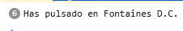

# Evidencias RA1 – Festival React

## Requisito 1: Tarjeta de concierto
(Explica que los datos están en un objeto en App y se pasan a ConciertoCard con props. Captura de la tarjeta.)

## Requisito 2: Navegador, Vite, HTML, CSS y JSX
(Qué ejecuta el navegador, qué hace Vite, para qué sirve cada uno. 2 ventajas y 2 limitaciones.)

## Requisito 3: Herramientas del navegador
### Elements
### Console
### Sources
### Network

## Requisito 4: Error de sintaxis y React DevTools

## Requisito 5: Formas de ejecutar JavaScript

## Pruebas

## capturas ->

