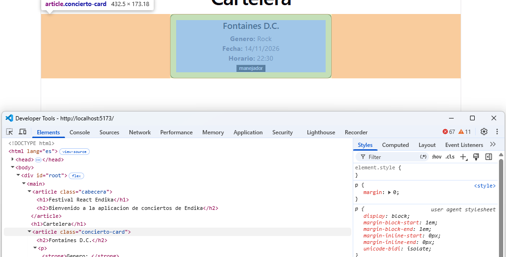
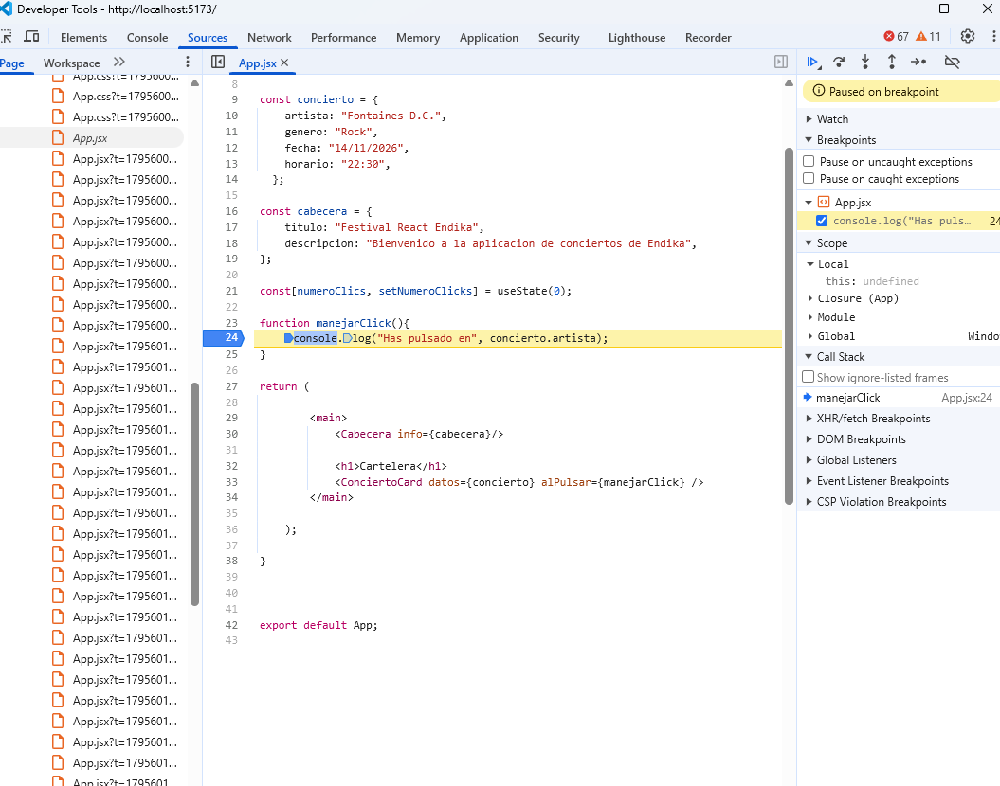
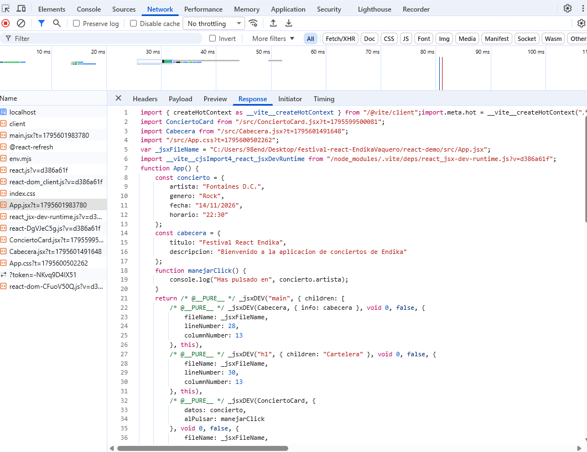
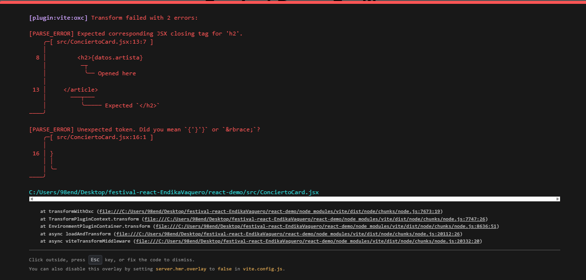

# Evidencias RA1 – Festival React

## Explica qué ejecuta el navegador, qué transforma Vite y qué función cumplen HTML, CSS y JSX. Identifica dos ventajas y dos limitaciones.

El navegador ejecuta JS, procesa el HTML y el CSS para construir y aplicar los estilos en la página. Como no entiende JSX directamente se utiliza Vite . Vite transforma los jsx, compuestos de un html y js a la vez, en codigo javascript que empaqueta y optimiza para luego ser procesado.

Dos ventajas: 
Separar cada pieza de la web (Cabecera.jsx , conciertoCard, app etc.) facilita la iteración, tener todo organizado y actualizar las vistas de manera más rápida y sencilla.
Además, JSX permite pasar datos y renderizar dinamicamente con JS, lo cual ahorra mucho codigo; se logra más con menos codigo que con herramientas más habituales.

Dos limitaciones:
Se necesitan varias herramientas en activo para que los datos se procesen y se entiendan entre las diferentes clases. Puede resultar abrumador para alguien que acaba de empezar.
Tambien, el navegador necesita descargar y ejecutar el JavaScript de la aplicación para renderizar buena parte de la interfaz dinámica, lo que puede implicar mayor peso de bundle inicial o menor visibilidad inmediata

## capturas ->

